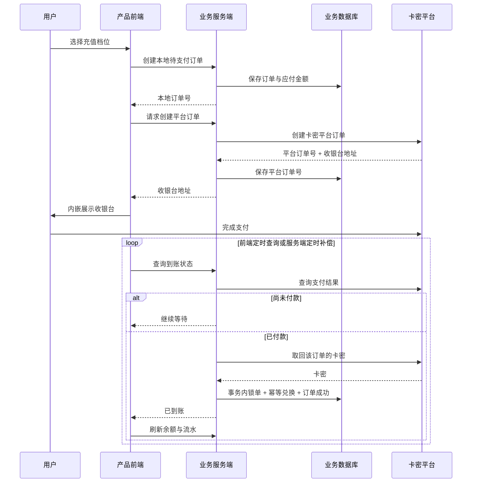

# Ai易道场 | 卡密平台「无感充值」接入参考

**Ai易道场 · [www.aiydc.com](https://www.aiydc.com)**
**影视·国学·通用三大赛道**
**已上线：影视剧本评估系统（https://ss.aiydc.com/）、国学占卜应用（https://yjmy.aiydc.com/）**
**即将上线：命理应用、剧本创作应用、短剧出海应用，欢迎关注**
**注册邀请码：RJVRCSJ7 赠送十元代币（作者推广链接）**

> 本文由 Ai易道场统一账户与计费系统的实践经验整理，介绍一种将「卡密平台下单 → 获取卡密 → 回站兑换」改造成「站内付款 → 自动到账」的通用实现思路，让更多产品接入无感充值，提升用户体验。该技术仅供想要试探商业模式、但又暂时无条件注册工作室或公司的个人开发者短期测试使用，不建议作为长期生产环境使用。

---

## 1. 方案目标

传统卡密充值一般分为两步：

```text
用户在卡密平台下单付款
→ 平台发放卡密
→ 用户回到自己的产品手动输入兑换
```

无感充值要解决的是把中间环节隐藏起来：

```text
用户在你自己的产品内选择金额
→ 拉起卡密平台收银台
→ 用户完成付款
→ 服务端自动查询付款结果
→ 自动取回卡密并完成兑换
→ 余额或权益自动到账
```

最终用户体验与普通在线充值一致，不需要看见或输入卡密。

---

## 2. 整体架构



### 推荐模块

```text
订单模块
  - 创建本地待支付订单
  - 服务端校验金额和商品档位
  - 保存平台订单号

卡密平台适配模块
  - 创建平台订单
  - 查询支付状态
  - 获取订单卡密
  - 超时、重试和开关控制

结算模块
  - 校验订单状态
  - 取回卡密
  - 调用统一兑换逻辑
  - 将本地订单置为成功

兑换模块
  - 手动兑换与自动兑换共用
  - 卡密锁定
  - 权益发放
  - 兑换记录

补偿任务
  - 扫描长时间待支付订单
  - 主动查询平台状态
  - 处理用户付款后关闭页面的情况
```

---

## 3. 最关键的设计：必须代兑，不能直接加余额

卡密平台出售的商品本质是卡密。付款后，平台通常仍会向用户预留的联系方式发送一张真实卡密。

如果业务系统确认付款后直接给用户增加余额，却没有消费那张卡密，就可能出现：

```text
业务系统直接到账一次
+ 用户拿平台卡密再兑换一次
= 同一笔付款到账两次
```

正确做法是：

1. 确认平台已付款；
2. 取回该订单的卡密；
3. 使用与手动兑换完全相同的兑换逻辑；
4. 在同一个数据库事务中完成权益发放、兑换记录和订单状态更新；
5. 兑换成功后才把本地支付订单置为成功。

这样可以保证：

- 一张卡密只能使用一次；
- 自动兑换不会绕过手动兑换的风控与约束；
- 发放失败时不会错误地把订单标为成功；
- 用户手中的卡密仍可作为人工兜底凭据。

---

## 4. 稳定身份字段

很多卡密平台在查询订单或领取卡密时，要求提供下单时的联系信息、查询口令或校验字段。

这个字段必须满足：

- 下单时生成；
- 后续查询时能够确定性复现；
- 不包含明文敏感信息时可使用稳定哈希；
- 不能每次随机生成。

推荐设计：

```text
有已验证联系方式：使用规范化后的联系方式
无联系方式：使用“业务前缀 + SHA-256(用户ID + 固定上下文)”的稳定值
```

需要特别注意：这个字段可能同时承担“用户联系方式”和“订单查询凭据”两个职责。生成规则一旦变化，历史订单可能无法取回卡密。

---

## 5. 订单状态机

建议把支付状态与权益发放状态分开考虑。

### 5.1 支付订单状态

```text
created
→ pending
→ paid
→ fulfilled
```

或者使用简化的三态模型：

```text
pending → success
pending → failed
```

但只有完成卡密消费和权益发放后，才允许进入 `success`。

### 5.2 失败处理原则

```text
可以确认没付款：保持 pending 或置 failed
已经付款但取码失败：保持 pending，进入人工核对
已经付款但兑换失败：保持 pending，不要直接加余额
用户已自行兑换：直接完成订单，不重复发放
```

核心原则：

> 宁可订单保持待处理等待人工核对，也不要为了“看起来成功”而重复发放权益。

---

## 6. 幂等设计

支付系统至少要防止四种重复：

1. 前端重复发起状态查询；
2. 多标签页并发查询；
3. 平台重复返回同一订单；
4. 自动兑换与用户手动兑换同时发生。

推荐组合使用以下约束：

### 6.1 本地订单唯一

每个本地订单号必须唯一。

### 6.2 平台订单唯一事件

为每个平台订单号建立唯一结算事件，例如：

```text
settlement_event(provider_order_no) UNIQUE
```

首次插入成功者获得结算权，重复请求直接返回“已处理”或“处理中”。

### 6.3 订单行锁

结算事务内先锁定本地支付订单：

```sql
SELECT *
FROM payment_orders
WHERE order_no = :order_no
FOR UPDATE;
```

### 6.4 卡密行锁

兑换事务内锁定卡密记录：

```sql
SELECT *
FROM redeem_codes
WHERE code = :code
FOR UPDATE;
```

### 6.5 用户兑换唯一约束

同一用户对同一卡密只能兑换一次：

```text
redemption_record(code_id, user_id) UNIQUE
```

### 6.6 事务边界

推荐在同一个事务中完成：

- 写入结算事件；
- 锁定订单；
- 锁定卡密；
- 发放余额或权益；
- 写入兑换记录；
- 更新卡密使用次数；
- 更新订单状态。

任何一步失败，都应该整体回滚。

---

## 7. 前端交互建议

前端只负责展示和发起查询，不接触平台凭据，也不接收卡密原文。

推荐流程：

1. 用户选择服务端下发的固定充值档位；
2. 创建本地订单；
3. 获取卡密平台收银台地址；
4. 使用 iframe 或新窗口展示收银台；
5. 定时请求业务服务端查询到账状态；
6. 成功后刷新余额、权益和流水。

建议参数：

- 轮询间隔：3 秒；
- 单次等待上限：5 分钟左右；
- 达到上限后提供“我已支付，重新核对”按钮；
- 单次网络失败不停止轮询；
- 成功后停止轮询并刷新资产。

前端不要：

- 自行判断支付成功；
- 保存或暴露卡密原文；
- 保存平台密钥；
- 信任客户端传入的金额或发放数量。

---

## 8. 服务端补偿任务

只依赖浏览器轮询会有一个明显问题：

> 用户付款后立刻关闭页面，订单可能长期停留在待处理状态。

建议增加服务端定时补偿任务：

```text
每隔 1～5 分钟：
  查询最近一段时间内仍为 pending 的卡密平台订单
  → 主动查询平台支付状态
  → 已付款则调用与实时查询完全相同的结算函数
  → 未付款则保持待处理
  → 超过有效期的订单进入人工核对或关闭
```

补偿任务应复用同一个结算函数，不要在定时任务里复制一套发放逻辑。

---

## 9. 异常与人工兜底

| 场景 | 建议处理 |
| --- | --- |
| 平台网络超时 | 保持待处理，稍后重试 |
| 用户尚未付款 | 继续等待或按有效期关闭 |
| 已付款但平台未返回卡密 | 记录异常事件，保持待处理，人工核对 |
| 卡密不在本站库存中 | 不要直接发放，进入人工处理 |
| 用户已手动兑换 | 订单置成功，但不再重复发放 |
| 平台接口大面积异常 | 关闭自动充值入口，保留手动兑换通道 |
| 平台订单与本地订单金额不一致 | 拒绝自动入账，人工核对 |

---

## 10. 对账建议

建议每天至少核对一次：

- 本地订单号；
- 平台订单号；
- 支付金额；
- 支付状态；
- 权益发放状态；
- 卡密兑换状态；
- 人工处理记录。

异常订单应保留完整链路：

```text
本地订单
→ 平台订单
→ 查询结果
→ 取码结果
→ 兑换结果
→ 权益流水
```

但日志中不得记录卡密原文、完整查询口令或用户敏感信息。

---

## 11. 安全要求

### 11.1 金额与商品由服务端决定

客户端只能提交商品档位或固定金额标识，不能直接决定：

- 实际支付金额；
- 到账余额；
- 赠送权益；
- 卡密类型；
- 订单状态。

### 11.2 卡密是敏感凭据

- 不返回给前端；
- 不写入普通日志；
- 不写入错误上报；
- 不放在 URL 参数中；
- 只在服务端结算流程中短暂使用。

### 11.3 平台凭据不下发浏览器

平台 token、密钥、签名和支付渠道配置必须只存在于服务端。

### 11.4 查询接口必须校验订单归属

用户只能查询自己的订单，不能通过修改订单号读取他人支付状态。

### 11.5 自动入口必须具备总开关

出现平台故障、风控或对账异常时，应能立即关闭在线支付入口，不影响手动兑换。

---

## 12. 上线前测试清单

- [ ] 正常付款后余额或权益只增加一次；
- [ ] 两个标签页同时查询，不会重复到账；
- [ ] 多个结算请求并发执行，只有一个成功发放；
- [ ] 用户手动先兑换后，自动结算不会再次发放；
- [ ] 平台未返回卡密时，订单不会置为成功；
- [ ] 卡密无效或不在库存中时，订单进入人工处理；
- [ ] 用户付款后关闭页面，补偿任务能够完成结算；
- [ ] 重复点击支付产生多个平台订单时，历史订单仍可被核对；
- [ ] 平台订单金额与本地订单不一致时，拒绝自动入账；
- [ ] 卡密原文不出现在日志、前端响应或错误上报中；
- [ ] 关闭在线支付入口后，手动兑换仍然可用；
- [ ] 订单、流水、兑换记录可以完整对账。

---

## 13. 接入步骤

1. 确认卡密平台提供可合法使用的下单、查单和取码能力；
2. 梳理商品档位、支付金额和发放权益的一一对应关系；
3. 设计本地订单与平台订单的映射；
4. 设计稳定的订单查询身份字段；
5. 实现统一的卡密兑换逻辑；
6. 实现订单锁、卡密锁和结算幂等；
7. 接入前端收银台与轮询；
8. 增加服务端定时补偿任务；
9. 增加人工核对、对账和总开关；
10. 完成重复发放、并发、取码失败和用户抢兑测试。

---

## 14. 总结

卡密平台「无感充值」的关键并不只是拉起收银台，而是保证以下不变量：

```text
一笔付款只到账一次
一张卡密只兑换一次
订单成功必须建立在权益真正发放之后
自动兑换与手动兑换必须共用同一套规则
用户付款后即使关闭页面，也能通过服务端补偿完成结算
```

做好这些约束后，卡密商品也可以获得接近原生在线充值的用户体验。

---

## 关于 Ai易道场

**Ai易道场** 打破信息垄断，实现信息平权。
**影视、国学、通用三大赛道**
官网：[www.aiydc.com](https://www.aiydc.com)

> 本文仅作通用技术方案参考。实际接入应遵守卡密平台服务条款、支付合规要求及所在地相关法律法规。优先使用平台正式 API、签名机制和支付回调；涉及非正式接口时，应自行评估稳定性、合规性和资金风险。
